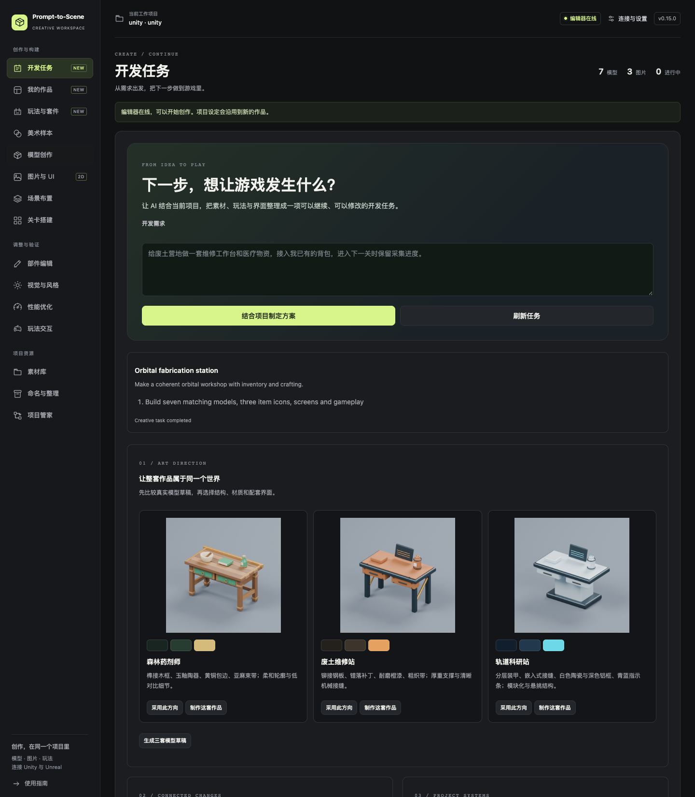

# v0.15：从开发需求到可运行游戏

v0.14 已[合并发布](https://github.com/316sandon12/prompt-to-scene/releases/tag/v0.14.0)。本页介绍后续 v0.15 开发版；正式下载入口在 v0.15 发布前仍提供 v0.14。

打开工作台的 **开发任务**，写下希望玩家能做什么，例如：

> 给废土营地制作维修工作台和医疗物资，沿用已有背包；模型、道具图标和界面配色统一，进入下一关时保留采集进度。

点击 **结合项目制定方案**。在支持交接的宿主中直接继续对话；否则复制生成的指令给 Codex／DeepSeek Harness。AI 读取项目设定、现有作品、玩法规则、风格样本和场景，保存具体的执行计划。用户已经要求直接制作时，宿主可以继续执行，不必为每个步骤重复确认。

## 五项工作流

| 方向 | 现在可以做什么 | 保留什么 |
| --- | --- | --- |
| 统一开发任务 | 按顺序组织复用、生成、道具、UI、交互、玩法、关联更新、视觉检查和打包；显示执行理由；失败后继续未完成步骤 | 原有项目、已完成阶段；不会重跑已完成的生成 |
| 成套美术 | 森林药剂师、废土维修站、轨道科研站三套结构与材质；先看真实工作台模型草稿，再制作七件模型、三个图标和原生 UI | 玩家控制器和场景灯光；采用新主题需要明确选择 |
| 关联修改 | 预览模型 → 图标 → 道具 → 界面的影响；修改部件后只刷新相关内容；撤销这一次更新 | 稳定 ID、背包数量、玩法规则、手工名称和界面布局；后来的版本会阻止过期撤销 |
| 项目系统接入 | 读取引擎里选中的实际对象，列出接口；Unity 可生成类型明确的转发组件，等待编译后绑定；UE 可创建可编辑适配蓝图、识别并绑定已实现接口的 Actor | 原项目的数据所有权和存档；不猜测私有字段，不拆分原子事务 |
| 游戏交付 | 把已有玩法接入下一场景；迁移旧存档 ID；生成当前电脑平台的原生运行包并一键启动 | 游戏构建设置、旧存档备份、最终运行文件；清理只处理此任务拥有的暂存文件 |

## 比较美术方向

**生成三套模型草稿** 会用 Blender 建立并渲染真实几何，使用相同构图和灯光。有效的比较结果会复用，避免重复渲染。森林方案使用木作和陶器；废土方案使用铆接、补丁和机械支撑；轨道方案使用分层面板、中央支座与指示条。它们并非给同一个模型换色。

选择方向后，可在 **玩法与套件** 创建完整套件。三个物品仍使用稳定的内部用途 ID（`herb`、`bottle`、`potion`），显示名称随主题变化。每个套件自己的界面使用相应配色。`select_art_direction` 的 `palette` 支持背景、表面、强调色等项目配色；表面和强调色同时作用于新模型的相应材质。全局 UI 主题只在勾选相应选项时改变。

这三套是可编辑的原创参数化范例，不是任意题材的生成模型。超出其造型范围时，宿主仍需根据游戏背景和已保存的实际图片编写定制 Blender 脚本。棚拍草稿不等同于引擎画面；最终效果使用现有游戏相机检查。

## 修改和撤销

1. 在 **关联修改** 选择模型，读取实际部件和关联道具。
2. 选择部件与颜色、粗糙度或缩放，预览影响范围后应用。
3. 手绘图标可以取消 **重新渲染关联图标**。一个图标被其他模型共用时，系统会要求保留图标或先拆分引用。
4. 完成后可 **仅撤销这次更新**，恢复先前几何和图标，再更新稳定的道具引用。模型、图标、道具或相关界面记录已有后续版本时，撤销会停止。

撤销不清空背包、不重建手工界面，也不是整个项目的回滚。中断时在任务卡选择继续；部分已经完成的导入仍保留可用。

## 接入已有系统

先保存场景，在引擎中选中管理背包和生命值的对象，再点 **读取选中对象**。

Unity 自动转发支持：`int Method(string)` 查询数量、公开 `float` 字段／属性读取当前和最大生命，以及 `bool Method(ItemQuantity[], ItemQuantity[], float)` 一次提交消耗、奖励和治疗。向导会显示实际候选，不会把普通的 `AddItem`／`RemoveItem` 擅自拼成事务。生成的 C# 保存在 `Assets/PromptToScene/Adapters`，编译通过后挂到所选对象并绑定玩法。已修改的生成代码不会被覆盖。缺少适合的 API 时，先实现一个公开的原子提交方法，或使用可编辑示例。

UE 使用 `BPI_PTSProjectAdapter` 的 `ReadQuantity`、`ReadHealth`、`CommitGameplay`。向导可以创建项目内的 Blueprint 示例，其事务默认关闭，供开发者／宿主接到真实游戏 API。已有接口实现可直接扫描、准备和绑定。**当前不自动重写任意项目的 Blueprint 图表**；未知的背包实现需要补全接口，完成后再扫描。普通插件和生成的蓝图无需 C++ 编译器。

外部系统始终负责保存自己的背包和生命值；桥接存档仅管理它自己的流程状态。

## 跨场景、旧存档和运行包

在第二个场景中选择玩法，点击 **接入当前场景**。只绑定该场景实际存在的匹配对象与界面，不复制整个关卡，也不要求每个场景放齐所有交互物。每个场景需要使用的外部适配器要单独绑定。

- Unity 在本次游戏进程内共享状态，关掉自动存档后仍能跨场景继续。
- UE 的 `persist_on_travel=true` 在切换关卡时保存桥接状态，再在目标关卡读取；即使逐动作的 `autosave=false`，切关卡仍会写这份存档。两项都关闭则不保证切关卡保留。
- 修改道具或规则 ID 后，在迁移区指定旧 ID → 当前 ID，并提升 `save_version`。旧数量和一次性完成标记会转换；超出堆叠上限或未来版本存档会拒绝覆盖。Unity 保留 `.bak`；UE 在迁移前保留 `_before_vN` 槽。别名不能指向不存在的对象、当前仍使用的旧 ID或重复目标。应保留累计迁移别名，使较老存档也能升级。

先保存场景与资产，再点击 **生成游戏运行包**。Unity 使用指定场景或已启用的构建场景；UE 使用指定 `/Game` 地图或当前地图。输出位于游戏项目 `.local/pts-deliveries/<任务 ID>`，不会修改用户的构建场景列表或默认地图设置。**启动游戏** 在 UE 中显式打开此次打包的第一张地图。

构建需要引擎对应平台的模块和 SDK。运行包完成不代表玩法或画面自动合格；任务中明确区分构建成功与实际运行验证。工具包下载大小和用户游戏的运行包大小是两件事，UE 运行包会包含引擎文件。

成功交付后移除本任务的暂存副本，保留运行文件、收据和必要日志；清理按钮可删除该任务的构建日志。源码、插件依赖、撤销数据和其他项目缓存不在清理范围内。

验证范围与限制见 [v0.15 验证记录](verification-v0.15.json)。目前原生编辑器与运行包验证在 Mac 上完成；Windows 的工具包构建检查不能代替 Windows 原生引擎验证。UE 模板保存版本是 5.7.2；较旧版本、HDRP、联网存档和任意第三方系统的适配未在此版本中认证。

## 维护者复现

这些原生测试只在可丢弃工程中运行，会修改场景、构建设置和测试存档。不要将驱动放入真实游戏。

1. 在仓库 `.local/iteration-v15/unity` 建立空白 Unity 工程，在 `.local/iteration-v15/unreal/Continuous.uproject` 建立空白 Blueprint 工程。设 `PTS_HOME` 为同目录下的 `home`，通过 `registry.connect(..., install_bridge=True)` 安装当前源码插件；配置本机 Blender。
2. Unity 工程的 `Assets/Editor` 放入 `tools/UnityGameplay.cs`、`tools/UnityContinuous.cs`；`Assets` 放入 `tools/FixtureProjectAdapter.cs`、`tools/FixtureInventory.cs`。打开编辑器并执行 `UnityGameplay.Run` 后，在仓库运行 `uv run python tools/continuous_smoke.py`。
3. UE 编辑器打开该工程，以 `-ExecutePythonScript=<仓库绝对路径>/tools/unreal_continuous_driver.py` 启动驱动，再运行 `uv run python tools/continuous_unreal_smoke.py`。测试工程只需要正常安装版插件，不要安装模板构建器。
4. 测试会创建缺失套件、执行实际原生操作，并写入同目录的精简 JSON 证据。运行包需要平台 SDK；启动检查单独执行，不用构建成功替代实际运行。保留证据后退出这些编辑器，清理测试工程和其测试存档。

常规 Python 检查使用 `uv run pytest -q`；修改哪个原生流程就运行对应引擎验证。更改文档不需要重跑建模、引擎或打包。
