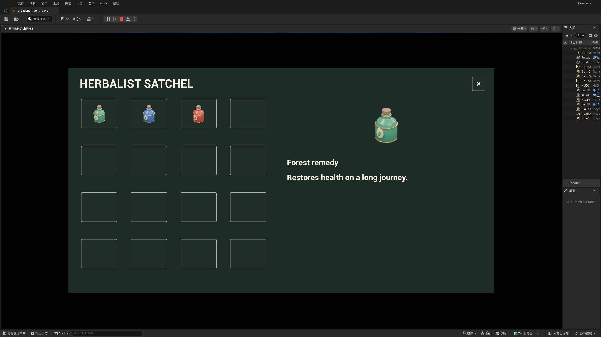

# 从一个想法，到一套游戏资产

v0.13 把模型、图标、物品数据和游戏界面接到同一个作品流程里。先安装最新应用并连接 Unity / UE 项目，打开引擎，再打开「创作台 → 我的作品」。第一次可以点「先体验一个完整药水套件」：Blender 会制作内置药水，渲染透明图标，导入物品数据并放置一个可拾取实例。这个示例无需图片服务或额外 API 费用。

## 用指令制作自己的作品

可以直接在 Codex / DeepSeek Harness 中说：

> 给我的森林探索游戏做三种手工药水：生命、法力、体力。陶瓷瓶身、暖金色瓶箍和叶片封印。模型、透明背包图标、可拾取物和物品数据都做出来，并放进原生背包 UI。

也可以在「我的作品」输入描述、选择成果，再点「准备制作」。支持发送消息的嵌入宿主会接到任务；本地窗口会准备好可复制的指令。宿主负责理解描述和编写建模代码。单纯文字模型不能生成图片；图标可由实际模型渲染，其他美术图片需要宿主图片工具或自己配置的图片服务。

每件作品使用固定 ID。模型修改后，在作品里点「从当前模型更新套件」，会重新渲染图标并更新原生引用，保留开发者改过的名称、描述、堆叠上限和交互事件。原模型保留，新增拾取实例放在旁边，方便比较与集成。

## 继续精修

- **模型**：打开作品 → 查看模型。拖动旋转、滚轮缩放、单击部件；也可用部件下拉框和方向键。点选会打开部件编辑，几何锁和材质锁继续生效。预览使用实际 Blender 几何与近似材质；最终光照、透明和贴图看引擎画面。已有源文件版本可在原有版本功能中恢复。
- **图片**：打开「修改图标」，拖出矩形或输入归一化坐标，描述修改，交给 AI。生成的文件可交由 AI 接回，或粘贴路径点「预览这次修改」。前后对照后点「采用」，也能恢复原版。选区外的原始像素由本地合成器保留。
- **风格**：「美术样本」保存真实图片、正面/反面判断和理由，按模型、图标、界面、材质分类。样本源文件复制进项目，外部临时图删除后仍可使用；旧版可恢复。模型与图片计划自动读取对应分类和材质样本。这是可追溯的美术参考，不是训练模型。

## 创建可编辑游戏 UI

在「我的作品 → 创建游戏界面」选择类型、关联物品和界面 ID：

| 类型 | 原生内容 | 继续开发的位置 |
| --- | --- | --- |
| 背包 | 16 个槽、物品图标、名称/描述详情、选物事件 | 接入装备、使用、存档、背包容量等玩法 |
| HUD | 生命条、4 个技能/物品图标位 | 用公开接口更新生命与技能图标 |
| 暂停 | 继续、设置事件、暂停/恢复 | 自行接设置面板、音量、按键映射 |

Unity 生成 `Canvas` 预制体与 `GameUIScreen`，数据是 `GameItem` ScriptableObject，拾取物是 `GameItemPickup`。`SetHealth`、`SetSkillIcon`、`SelectItem`、`ShowPanel`、`onSettings` 等接口可接现有控制器。示范拾取会更新已配置物品的数量，完整存档、背包业务规则仍由游戏决定。

UE 生成可编辑的 Widget Blueprint、DataAsset 和 Pickup Blueprint。通过 `ItemData` / `OnInteracted` / `GameEventId` 接拾取逻辑，通过 `SelectItem` / `OnItemSelected` / `SetHealth` / `SetSkillIcon` / `OnSettings` 接 UI。默认展示已配置的物品目录，UE 背包持有数量需接入自己的库存系统。

示范输入为 I 打开背包、Esc 打开暂停；在 Unity `demoShortcuts` 或 UE Host 的 `DemoInput` 关闭示范输入，改由自己的控制器驱动。默认 UI 是可调整的起点，支持原生布局缩放，不会替代项目完整的 UI / 游戏逻辑。

相同 `screen_id` 更新会保留布局、标题和事件，更新物品引用。勾选「更新已有界面的配色」才会重设管理的颜色与字号；普通更新不会抹掉手工配色。不要删除仍用于事件绑定的命名控件。

## 版本与故障恢复

模型与图片源版本、美术样本和主题版本留在项目 `.prompt-to-scene` 下。不要把这些当作临时缓存清理。引擎离线时，导入任务会等待；重新打开编辑器即可，不要重复生成。失败任务可以继续同一个任务，已完成的步骤不会因为轮询重复执行。

图片局部修改要求基于最新准备的版本。宿主输出须与原图或选区裁剪的精确尺寸一致；内置兼容图片 API 会同步缩放/填充图像与遮罩，再还原尺寸。模型生成遮罩是参考，插件通过合成确保选区外不变，仍需检查边缘衔接与选区内画质。[OpenAI 遮罩说明](https://developers.openai.com/api/docs/guides/image-generation#edit-an-image-using-a-mask)。

当前验证目标为 Unity 2022.3 和 UE 5.7.2。UE 自带编译好的普通引擎资产，使用者无需安装维护用 C++ 生成器。功能范围是静态模型、图片和上述三种 UI 模板；任意菜单、骨骼动画、自动语义拆分不在这一版范围内。
