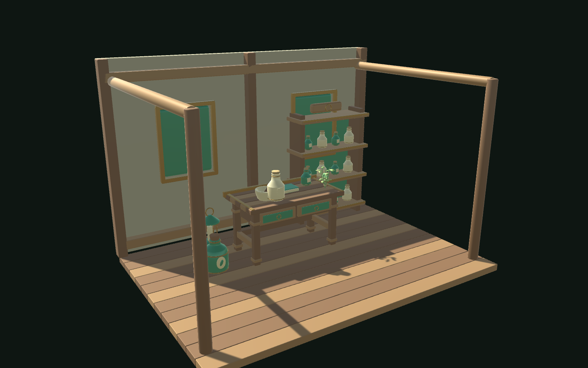
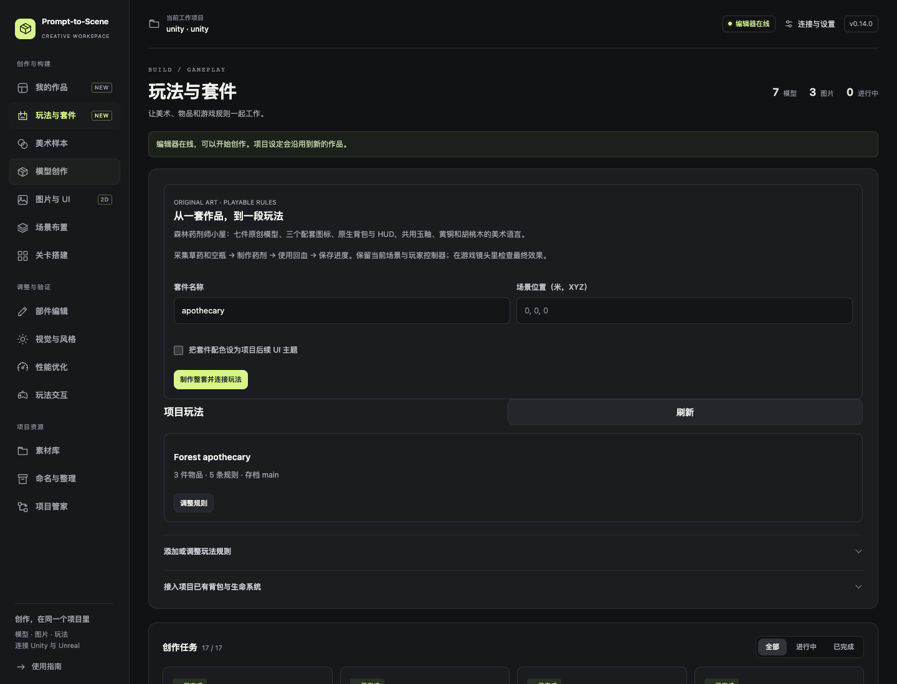
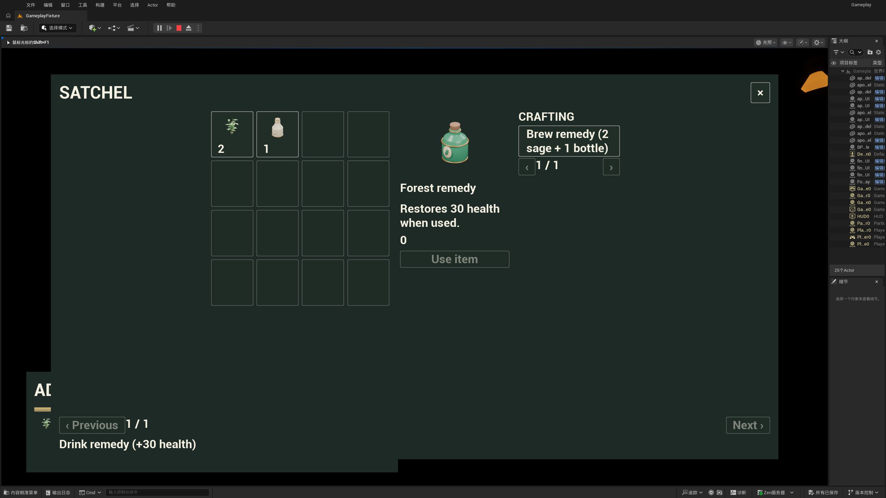

# 玩法与成套美术 · v0.14

打开 Unity 或 UE 项目，再打开 Prompt-to-Scene 创作台，进入 **玩法与套件**。已有安装需要先更新工具及项目桥接插件；UE 更新桥接后重启一次。

## 最快体验

点击 **制作整套并连接玩法**，等待同一个任务完成。默认名称 `apothecary` 会生成：

- 木结构小屋、工作台、陈列架、灯具、草药、瓷瓶和药剂；模型由原创 Blender 源码制作，可以继续修改。
- 草药、瓷瓶、药剂的真实透明渲染图标、原生物品数据。
- 可编辑的原生背包、HUD、暂停界面。
- 拾取草药和空瓶 → 消耗 2 份草药与 1 个空瓶制作药剂 → 使用药剂恢复 30 点生命 → 保存进度。

有现成玩家控制器时，沿用项目的输入与镜头调用交互。Unity 调用 `Interaction.TryInteract(玩家世界位置)`，UE 调用 `TryInteract(WorldPosition)`；两个方法都有距离检查。也可打开背包，在 Craft 中点击配方。原型默认快捷键为 I／Esc；UE 另有手柄 View／Menu 示例快捷键。正式游戏可以关闭示例输入，改由自己的 Input Actions 调用 `ShowPanel`／`Toggle`。

套件保留当前玩家、灯光与地面碰撞；它是一组可接入项目的道具与规则，不会替换整个游戏。小屋是开放式展示结构。已有角色控制器需要项目自己的可行走地面。套件完成后，从实际玩家镜头检查遮挡、尺寸和材质；任务成功只代表制作与导入完成。

名称代表一套稳定资产。再次使用同一名称会返回已有结果；中断后从任务卡恢复，避免生成重复物品。制作另一套时换名称和放置位置。只有勾选“把套件配色设为项目后续 UI 主题”才会修改项目主题和接受套件材质参考。



上图是同一组模型在 Unity Built-in 中的实际渲染。它是可继续编辑的风格化示例；不同项目的灯光、后处理和镜头会影响最终效果。

## 直接用指令

Codex 和 DeepSeek Harness 继续共用 `game_workflow`，不增加安装步骤。可以直接说：

> 在当前项目做一套森林药剂师小屋，连接草药和空瓶的采集、药剂制作、背包使用与存档。保留我的玩家控制器和当前场景灯光，完成后从游戏镜头检查画面。

或修改已有游戏：

> 把现有钥匙和木门接起来：拥有钥匙才能开门，开门消耗钥匙，只触发一次，重进游戏保持开启。保留门的材质和我已经写好的事件。

AI 先读取 `gameplay_flows`，通过 `describe` 获取契约，再调用 `configure_gameplay`；成本和奖励使用已创建的物品 ID。不会执行字符串表达式或把任意代码塞进规则。

## 调整玩法，不需要写 JSON

在“项目玩法”选择 **调整规则**，或展开“添加或调整玩法规则”：

1. 选择物品、要绑定的原生界面、生命上限、初始数量和存档槽。
2. 添加规则：场景交互、背包制作或使用物品。
3. 设置材料、奖励、回血、前置条件、是否仅一次，以及绑定的模型或拾取物。
4. 点击 **应用玩法到引擎**。保存 Unity 场景／UE 关卡，保留绑定。



一个流程最多 128 件物品、128 条规则；单条规则最多 16 种消耗、16 种奖励及 16 个前置条件。不能存在循环前置条件、负数、重复物品或重复场景绑定。使用规则必须消耗对应物品。

所有条件和容量先检查，成功后一起扣材料、发奖励和回血。材料不足、满血、容量不足或接口拒绝时不会先扣除部分物品。交互规则以**每次成功交互**为单位；需要多次采集后奖励时，在自己的采集完成事件调用规则。

更新保留流程资产身份、项目适配器和存档。已经完成的一次性规则继续完成；需要新开一局时明确换存档槽。界面和模型更新不会删除玩家进度。当前实现面向单机、一个场景内每个流程一个 Session；跨场景管理、多人同步、装备属性和任务编辑器仍由游戏负责。

## 接入已有背包与生命系统

内置背包开箱可用。接入真实项目时，实现一次适配接口，在工作台选择流程，点击 **查找可用接口 → 绑定此接口**。插件会持久引用原组件／Actor，不猜字段名，不在每次生成物品时重复绑定。

Unity 的组件实现 `PromptToScene.IGameProjectAdapter`：

```csharp
public int GetQuantity(string itemId); // 读取现有背包，返回非负数量
public float Health { get; }           // 当前生命，有限数值
public float MaxHealth { get; }        // 上限，大于零
public bool TryCommit(ItemQuantity[] costs, ItemQuantity[] rewards, float heal);
```

`TryCommit` 的实现先验证整笔操作，再一起修改项目背包与生命。返回 `false` 或抛异常时必须没有修改；不要在验证前逐个扣物品。已有背包提供事务 API 时直接委托给它。原有存档系统继续负责这些外部数据；插件只保存自己的规则完成标记。物品 ID 应映射到游戏自己的物品表。

UE 的 Actor 实现 `/PromptToScene/Templates/BPI_PTSProjectAdapter`：

| 接口函数 | 输入 | 输出 |
| --- | --- | --- |
| ReadQuantity | ItemId | Quantity |
| ReadHealth | — | Current、Maximum |
| CommitGameplay | Costs、Rewards（String→Integer Map），Heal | Success |

`/PromptToScene/Examples/BP_PTSProjectAdapterExample` 提供可编辑的接口示例。复制到项目，再把三个函数中的示例存储替换为游戏已有系统；示例本身不保存外部游戏数据。蓝图只依赖引擎运行节点，打包游戏不需要 Python 或维护用的 C++ 插件。

## 背包和界面

- 背包支持 128 件物品，每页 16 个位置；绑定玩法后展示已拥有物品及数量，空背包有提示。
- 物品详情展示说明和可用操作；配方按钮、物品使用和 HUD 生命跟随实际状态更新。
- 操作失败有原因；保存失败单独显示。控件支持原生键盘／手柄焦点与按钮状态。
- Unity 使用安全区和横竖屏布局；UE 使用 SafeZone、自动换行和滚动内容。
- Unity 组件／Prefab 和 UE Blueprint／UMG 都可继续手工编辑。关闭 Unity 的 `adaptiveLayout` 可固定自定义布局。

旧 UE v0.13 的 Widget Blueprint 是复制出来的独立图表。为保留手工布局与事件，不会强行覆盖它；用一个新的 screen ID 创建 v0.14 界面，再选择它绑定玩法。Unity 对现有界面补充缺失操作控件；深度定制过的布局应在应用后检查按钮位置。



[Unity 横屏背包](images/native-gameplay-unity-v0.14.png) · [Unity 竖屏布局](images/native-gameplay-portrait-v0.14.png)

## 按实际画面复用项目素材

在 **素材库 → 按画面和用途挑选可复用素材** 描述需求，可补充风格和尺寸。工具读取项目索引，拍摄少量真实引擎缩略图；不会批量上传整个项目。

你可以直接查看图片并保存“直接复用／需要调整／不合适”和理由，也可点击“让当前 AI 对比这些图片”。AI 使用宿主的视觉能力读取图片，不会自动调用收费生成服务。相同生成资产的不同导出文件优先合并为一个候选。

确认直接复用后，点击 **放入当前场景**，仍使用原生资产引用。来源文件或图像证据变化后会要求重新对比。尺寸来自引擎元数据；风格合适与否来自可见画面和项目设定，不提供虚构的“美观分数”，也不能根据图片判断许可证。

对应动作：`recommend_assets` → `recommendation_images` → `save_asset_matches` → `reuse_recommendation`。没有视觉判断的候选只是一组待比较素材。

## 存档与撤销边界

Unity 存在应用的 `persistentDataPath/PromptToScene`，UE 使用原生 SaveGame 槽。槽名由项目身份、流程 ID 和槽 ID 组成，避免不同流程混用。读取失败时保留旧文件并阻止覆盖，提示修复或选择新槽。插件不读取其他游戏的玩家存档。

编辑器内规则配置有修订检查和历史定义；历史定义不是玩家进度备份。Unity 写存档会保留上一次 `.bak`，UE 使用引擎 SaveGame 文件。接入项目适配器后，外部数据的保存与规则进度跨文件一致性由游戏自己的存档事务负责。

经过验证的平台与具体覆盖见 [v0.14 验证记录](verification-v0.14.json)。
