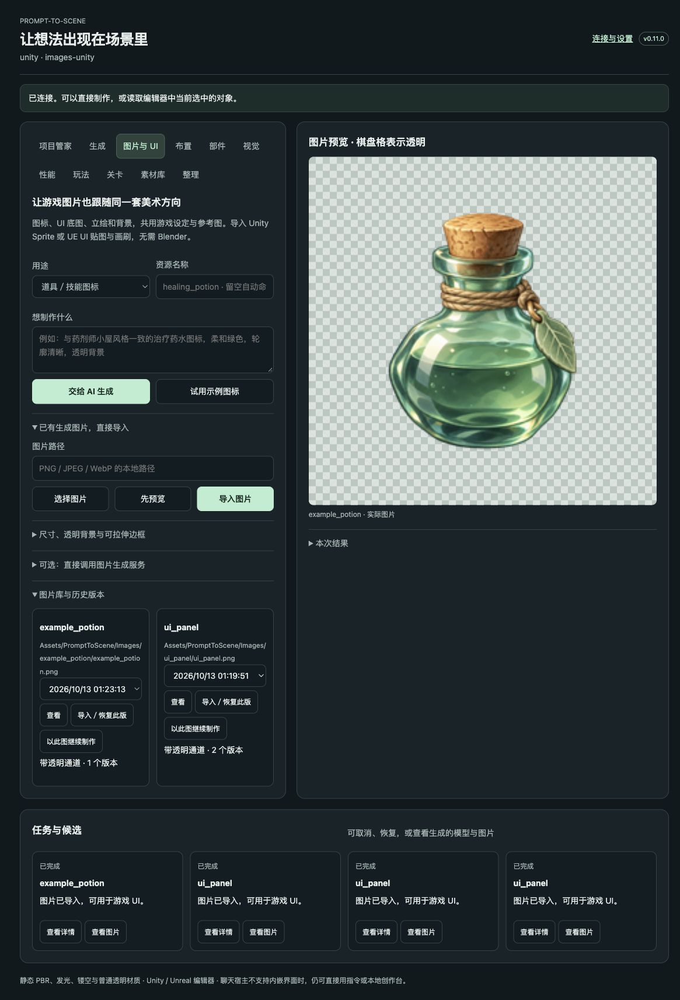

# 图片与 UI 素材工作流

v0.11 把游戏图片接入同一套指令、项目美术设定、任务记录与原生导入流程。支持道具／技能图标、按钮底图、面板底图、角色立绘、背景图和单张颜色贴图。图片流程无需 Blender。

## 最简单的使用方式

更新安装程序，重新点击「连接并准备项目」更新引擎桥接；UE 重启一次。保持目标编辑器打开并退出 Play 模式。在 Codex 或 DeepSeek Harness 中说：

> 给这个游戏生成一个治疗药水图标，跟随项目已有的背景和画风，透明背景，256 像素，直接导入 Unity。

> 做一张与现有科幻场景一致的背包面板底图，中心安静，边框可拉伸，不画文字，放进 UE。

> 做一张 1920×1080 的主菜单背景，左侧留出菜单文字区域，沿用项目参考图。

AI 会读取项目设定，准备图片描述，调用当前客户端可用的生图工具，再把实际图片文件交回插件处理和导入。**客户端需要有可用的图片生成工具**；只有文本聊天能力的模型需要接图片服务或导入其他工具生成的图片。插件不会把文字模型伪装成图片模型。

想先验证安装，打开 **创作工作台 → 图片与 UI → 试用示例图标**。内置一张实际 AI 生成的透明药水图标，不调用远程服务、不需要密钥。也可以说「用 Prompt-to-Scene 导入示例图片」。

已有图片时，选择用途，点「选择图片 → 导入图片」。默认尺寸与透明设置跟随用途；需要时展开高级设置。每个图片 ID 都会保留源文件和历史版本，在图片库点「导入／恢复此版」即可更新原资源。

点图片库里的「以此图继续制作」，会带入原图、用途、尺寸与描述。修改描述，再交给 AI 生成，就能继续迭代同一个资源。

示例图标由内置生图工具实际生成；[完整提示词与来源](../examples/images/README.md) 随源码保留。

## 图片会进入哪里

| 用途 | Unity | Unreal Engine |
| --- | --- | --- |
| 图标、立绘、背景 | Sprite，保留 Alpha，sRGB，关闭 mipmap，Clamp，UI 无损导入 | Texture2D，UI 压缩与 LOD 分组，关闭 mipmap，Clamp；附带 SlateBrushAsset |
| 按钮、面板底图 | Sprite + 九宫格 border；uGUI Image 的 Image Type 设为 Sliced | Texture2D + Draw As=Box 的 SlateBrushAsset，保存规范化 Margin |
| 单张颜色贴图 | 普通 Texture2D，Repeat，开启 mipmap | World 分组的 Texture2D，Repeat，默认 mipmap |

Unity 默认目录：`Assets/PromptToScene/Images/<asset_id>/`。

UE 默认目录：`/Game/PromptToScene/Images/<asset_id>/`，贴图前缀 `T_`，画刷前缀 `B_`。

Unity 可把 Sprite 拖到现有 uGUI Image 的 Source Image，或在 UI Toolkit 中作为图片资源。UE 可将生成的 Texture2D 用作 UMG Image 的 Brush Resource；Blueprint 中可以读取生成 SlateBrushAsset 的 Brush 并用 Set Brush 应用，沿用九宫格边距。已有 Widget 的布局、文字与按钮事件仍由项目控制。

更新使用相同原生资产：Unity 保留 GUID，UE 保留 Texture2D／SlateBrushAsset 路径及引用。目标存在不属于插件的资产时会停止。排队后又被其他任务更新的图片会拒绝过时导入；重新发布所选版本即可。不要手动修改 `.prompt-to-scene` 中的版本文件。

## 怎样让图片更适合游戏

- **风格一致**：沿用游戏玩法、世界背景、项目线性色板转换后的 sRGB 配色、美术参考和已保存的视觉偏好。参考图在计划中保留副本。AI 仍需查看实际图像判断是否匹配。
- **图标可读**：描述实际用途、显示尺寸和重点轮廓。先做好一张，再作为同系列的参考。
- **真正透明**：透明素材必须有真实 Alpha；全透明图片也会被拒绝。不会自动把白底抠除，更不会把画出来的棋盘格当成成功抠图；宿主生图工具可负责重新生成或编辑。
- **尺寸不变形**：默认透明素材等比缩放并留白，背景居中裁切铺满；可选择严格匹配原尺寸。放大与裁切会在结果中说明。像素画仅允许原尺寸或整数倍等比放大，使用最近邻采样和 Point／Nearest 筛选。
- **九宫格**：边距顺序统一为左、上、右、下，单位是最终图片像素。生成描述会提示让中心与边缘可拉伸；实际图案是否适合拉伸仍需看图确认。改尺寸后要按最终图片调整边距。
- **文字单独渲染**：按钮、面板生成底图，文字由引擎渲染，便于本地化、字号适配与后期修改。

支持静态 PNG、JPEG、WebP，源文件至多 20 MiB／16 百万像素；输出为 PNG，单边 16–4096 像素。保留原始文件，读取 EXIF 方向并转换内嵌 ICC 配置到 sRGB。动画图、多帧图、骨骼动画、自动 sprite sheet 分帧、整套 PBR 贴图与完整可交互菜单不在本版本范围内。普通贴图的 Repeat 设置也不代表 AI 输出已经无缝。

## 可选图片服务

工作台展开「可选：直接调用图片生成服务」，填入包含 `/v1` 的接口地址、服务实际支持的图片模型与密钥。模型由用户选择；密钥存入系统钥匙串／凭据管理器，也可以设置 `PTS_IMAGE_API_KEY`。项目文件和导入记录不保存密钥。

- `gpt_image`：按 [Images API](https://developers.openai.com/api/reference/resources/images/methods/generate) 调用 `/images/generations`。带参考时用 multipart `/images/edits`；返回 `data[0].b64_json`。具体模型须支持所选背景与编辑能力，透明能力不能仅由“兼容接口”保证。
- `b64_json`：通用文生图接口，传 `response_format=b64_json`，不发送参考图；有参考计划时会明确报错。默认请求 1024×1024 后本地适配目标尺寸。
- 原生 ComfyUI 的 `/prompt` 协议没有直接接入；需提供上述兼容适配器，或先生成文件，再交给 `import_image`。

远程调用前要明确选择服务和本次数量，勾选允许发送描述、参考图与消耗服务额度。配置密钥本身不会触发生成。接口不跟随重定向，不下载返回的任意 URL。发生网络超时、断电等结果不明情况时不会自动再次计费：可从服务恢复图片再导入，或者明确开始一个新任务。拿到图片之后导入失败，可以恢复任务，复用已保存图片。

未在真实付费图片 API 上验证本版本；兼容接口由本地 HTTP 服务测试覆盖生成、参考图上传、响应解析与恢复行为。宿主生图路径已用仓库里的实际示例测试。

## 给 AI／集成开发者

全部通过现有 `game_workflow` 发现与调用，安装后仍只暴露三个顶层 MCP 工具。Codex 和 Harness 共用此协议。

1. `plan_image(asset_id, prompt, kind, ...)` 返回冻结的项目美术描述、`plan_id` 和参考图路径；不会调用服务。
2. 宿主用自己的生图工具生成实际文件，调用 `import_image(asset_id, source, plan_id)`；也可明确调用 `generate_image(plan_id, allow_remote, preview_only)`。
3. `task(request_id)` 等待精确的原生回执。`image_preview(asset_id, revision)` 返回真实预览像素；不要用模型的 `get_preview`／部件编辑工具处理图片。
4. `image_library` 查历史；`publish_image` 导入已准备图片或恢复旧版。技术检查完成不代表用户已经接受美术效果。
5. 混合批次的 `produce` 支持 `method=image`，传生成好的图片 `source`、用途 `kind` 与可选 `parameters`。图片和模型共用父任务进度，只有模型参与三维摆放与游戏摄像机检查。

原生设置依据 [Unity TextureImporter](https://docs.unity3d.com/2022.3/Documentation/ScriptReference/TextureImporter.html) 与 [UE SlateBrush](https://dev.epicgames.com/documentation/en-us/unreal-engine/python-api/class/SlateBrush?application_version=5.7)。
