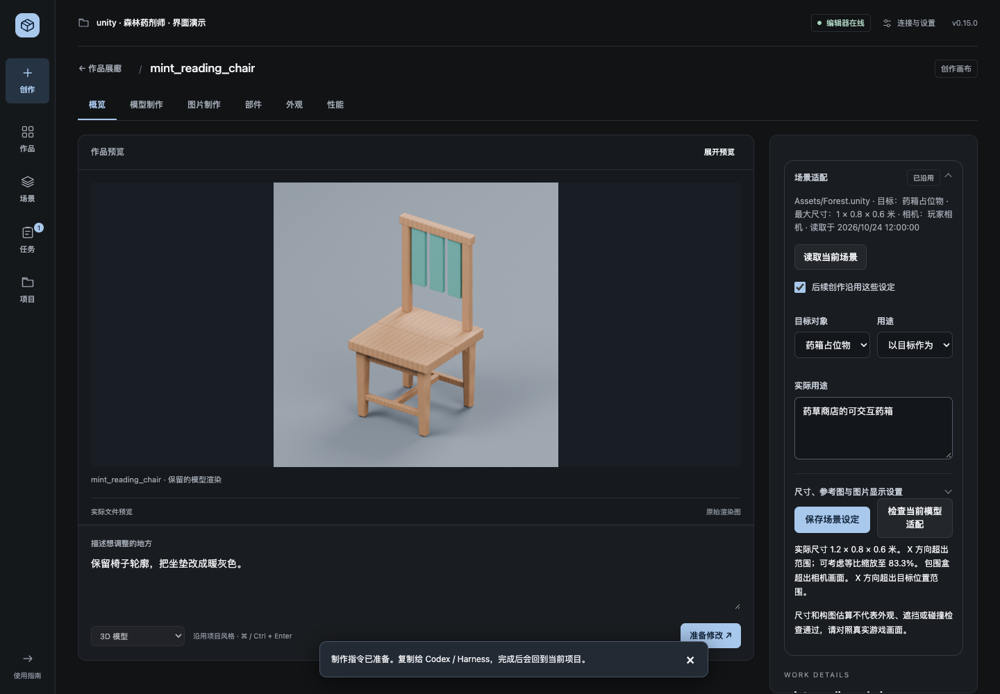

# 让模型和图片属于当前游戏场景

此功能在 v0.15 开发分支，正式 v0.14 下载包尚不包含。源码运行后重新连接项目更新桥接；Unity 等待编译，UE 重启编辑器一次。它把可测量的空间要求和实际参考图送进制作流程，AI 负责理解画面与设计，插件负责保存依据与检查结果。

## 最简单的用法

想同时取得真实游戏截图，可直接点「参考这里制作」；图片会自动保留，无需填写路径。临时试放、采用／撤销、用途要求和区域样本见 [场景创作操作说明](SCENE-STUDIO.zh-CN.md)。下面的「读取当前场景」现显示为「仅读取参数」，仍保留轻量读取方式。

1. 在 Unity／UE 中选中目标物体或占位模型。回到创作画布，展开 **场景适配 → 读取当前场景**。
2. 选 **以目标作为尺寸上限**，或只参考环境；描述实际用途。尺寸、参考图和图片显示设置按需展开，其余可以留空。
3. 在画布下方正常描述作品，点 **准备创作**。修改中的场景设定会一起保存，交给 Codex／Harness 使用。

例如：

> 参考当前药草店场景，把选中的占位物做成可交互药箱。不能超出它的大小；从玩家相机看，把手和药草标识要清楚。再做一张在背包中以 64×64 显示的透明图标，沿用药箱的颜色和轮廓，四边保留 10% 空白。

也可以直接在 AI 对话中提出上述要求，不需要手填参数。工具不会从物体名称猜测颜色；要判断实际外观，可以提供游戏截图，或让宿主查看已有的原生画面与美术样本。

此图为真实工作台页面，配合模拟场景记录、模拟检查结果和已有 Blender 椅子渲染展示交互；不是本次新生成的模型或引擎效果图。

## 自动继承的依据

- **实际空间**：引擎当前场景、选中对象、包围盒、邻近对象与材质路径。位置和大小统一使用米；Unity 的 Y 是高度，UE 的 Z 是高度。尺寸为引擎世界 XYZ 上限，不能直接抄成 Blender 的局部轴。
- **相机**：选择玩家相机，保存位置、朝向、透视或正交参数。Unity 优先 MainCamera，UE 优先带 `PTS.GameCamera` 标签的 CameraActor；多个候选不会猜选。
- **视觉参考**：场景图片保留独立副本，最长边 1280 像素。宿主可用 `match_game_style(use_scene=true)` 真正查看图片并保存有依据的材质、造型与细节判断。修改风格不会重做已有资产。
- **图片用途**：计划包含目标显示尺寸、图标留白与场景参考。图标借用场景的美术风格，不复制场景背景；普通图片生成仍由宿主生图工具或已配置的服务执行。

采集与保存设定不生成资产、不收费、不移动物体。勾选 **后续创作沿用这些设定** 后才参与新的计划。关闭勾选可暂停使用，既有模型／图片版本仍保留自己的制作依据。

尺寸留空时，只有选择「以目标作为尺寸上限」才从目标包围盒取值。显式填写尺寸始终作为上限；这是最大范围，不表示三个方向必须填满。参考模式适合只借鉴环境或风格，避免把药瓶错误地放大成整张桌子的大小。

## 生成后的具体检查

模型导入且已放入场景后，点 **检查当前模型适配**：

- 列出各实例的实测世界尺寸、超出的 XYZ 方向、等比缩小参考值。
- 在尺寸适配模式下，指出是否放到了目标范围之外。
- 用保留的相机参数估算包围盒在画面中的位置，指出超出画面或穿过近裁剪面的情况。
- 目标或相机发生变化时提示刷新依据，停止输出旧相机的构图估算。

图片导入报告中的 `scene_fit` 自动检查显示比例，以及透明图标／立绘是否侵入要求的边缘留白。比例不匹配会建议保持比例显示。工具不自动拉伸模型、挤压图片或改动手工资产。

这些检查不能证明材质美观、文字区足够安静、运行时相机正确、遮挡或通行空间合格。包围盒投影是保守估算；Unity 自定义投影、立体相机和分屏不作标准投影估算。UE 读取 CameraActor 参数，角色控制器动态相机需要另看实际游戏画面。外观仍应在真实游戏镜头、最终显示尺寸下比较。

## AI 工具流程

经 `game_workflow` 的 `describe`／`execute` 使用：

| 动作 | 用途 |
| --- | --- |
| `capture_scene_context` | 请求一次原生场景读取，随后用 `task` 等待完成。 |
| `save_scene_context` | 传 `inspection_id` 和必要 `settings`，可附 `reference_path`；不传参数则读取。 |
| `context` | 读取已保留的 `scene_context`，包含最多 12 个相关邻近对象与参考图。 |
| `design_asset` | 为模型保存本次具体设计；之后 `build_asset`／`produce` 将它保留到源码版本。 |
| `plan_image` | 保存图片计划，参考列表自动包含场景图；最多 4 张，其中场景图占 1 张。 |
| `check_scene_fit` | 传已导入的 `asset_id` 和新的 `inspection_id`，与该模型版本保留的依据比较。 |

新计划使用最新设定；进行中的生成和已有版本不被后来修改的设定改写。局部改图仍以原图作为第一张参考，保持原有选区外像素保护。外部建模服务提示词长度不足时，数值约束整体保留或在 `shortened_context` 中明确报告省略，绝不截断尺寸数字。

原生参数接口参考：[Unity 投影矩阵](https://docs.unity3d.com/ScriptReference/Camera-projectionMatrix.html)、[UE 5.7 SceneComponent](https://dev.epicgames.com/documentation/en-us/unreal-engine/python-api/class/SceneComponent?application_version=5.7)。本次范围和结果记录在 [验证记录](verification-scene-context.json)。
