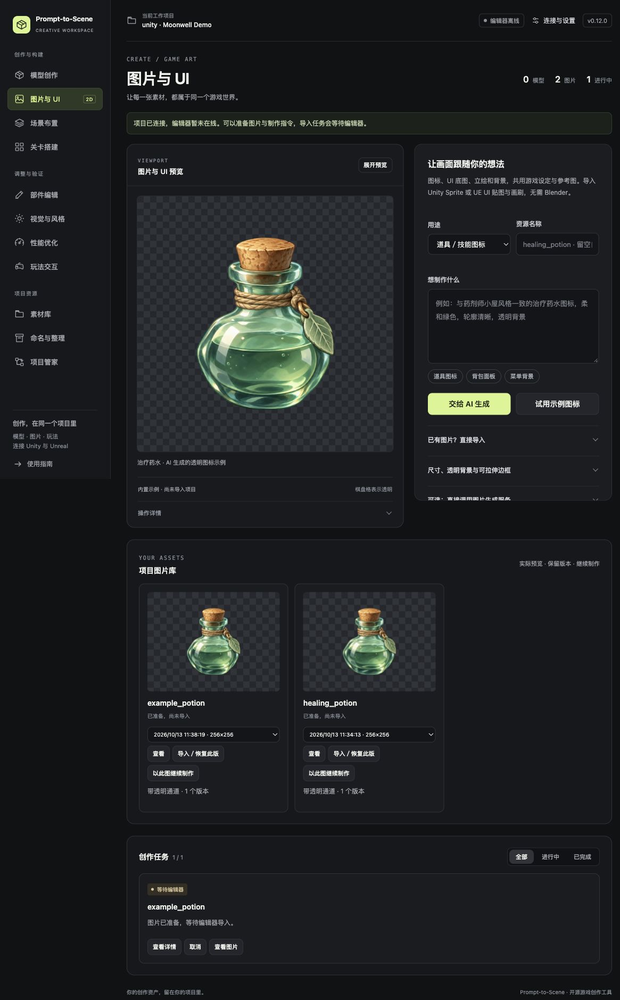

# 创作工作台

打开 Prompt-to-Scene，连接项目后点 **进入创作工作台**。这里把描述、预览、修改和任务放到同一个深色界面中。

截图使用临时示例项目；药水是内置真实透明图片，编辑器离线，导入任务正在等待处理。

## v0.13：先从「我的作品」开始

新增统一作品页、真实模型旋转与部件点选、图片局部修改、美术样本和原生背包/HUD/暂停菜单。[按步骤使用](CREATIONS.zh-CN.md)。上方旧版截图展示静态图片流程，新版模型可在「打开作品 → 查看模型」进入可交互视图。

## 从哪里开始

| 要做的事 | 左侧入口与操作 |
| --- | --- |
| 制作模型 | **模型创作**：写描述，点 **生成制作指令**，复制到当前 AI 对话；支持内嵌界面的宿主可点 **交给 AI 制作**。 |
| 制作图标、UI 底图或背景 | **图片与 UI**：选用途、写描述，点 **交给 AI 生成**。本地页面提供复制指令，图片由宿主可用的生图工具或你配置的服务生成。 |
| 先试图片导入 | **图片与 UI → 试用示例图标**，无需 Blender 或图片 API。目标编辑器在线后处理导入。 |
| 导入现成图片 | **图片与 UI → 已有图片？直接导入 → 选择图片 → 导入图片**。 |
| 布置场景和关卡 | **场景布置 / 关卡搭建**，沿用已有布局、模块与通行检查。 |
| 修改模型与风格 | **部件编辑 / 视觉与风格 / 性能优化**，先选已导入资产，按需读取编辑器选择。 |
| 添加交互 | **玩法交互**，制作或配置支持的交互道具。 |
| 找资源和管理项目 | **素材库 / 命名与整理 / 项目管家**，复用素材、预览整理方案或保存项目规范。 |

模型与图片的快捷描述可以直接点选，再改成自己的需求。尺寸、透明背景、九宫格和外部生成服务按需展开，日常制作不用逐项填写。

## 看作品和继续修改

中间区域显示真实图片文件、Blender 渲染或引擎截图。初次打开会显示明确标注的内置示例，浏览示例不会生成任务或导入项目；它不是实时可旋转的 3D 视口。

点 **展开预览** 暂时收起右侧参数，按 **Escape** 或点 **收起预览** 返回。原有前后对照仍在同一画布显示。

**项目图片库** 位于创作区下方，每张图都有真实缩略图、版本下拉框和三个操作：

- **查看**：显示所选版本的实际图片。
- **导入／恢复此版**：复用原资源身份，导入所选版本。
- **以此图继续制作**：带回原图参考、尺寸和描述，修改后继续生成。

棋盘格表示透明区域。是否符合游戏画风，还需要查看实际图片。

## 任务与连接

顶部显示当前项目、编辑器是否在线和模型／图片／进行中任务数量。编辑器离线时仍可准备制作指令与图片，导入会等待目标编辑器；状态不会显示成已导入。

下方 **创作任务** 可切换 **全部 / 进行中 / 已完成**。点 **查看详情** 展开对应结果，运行中的任务保留取消入口，支持恢复的失败任务保留恢复入口。

键盘可用 Tab 进入导航，再用方向键切换功能；Home / End 跳到首尾。窄窗口自动改为横向导航或单列布局。当前功能页在本次浏览会话中保留。

连接项目、安装客户端和生成首个示例木箱仍在 **连接与设置** 中；旧版入口收在 **原有快捷工具与高级操作**。更新方式见 [新手教程](QUICKSTART.zh-CN.md)，图片生成能力与格式范围见 [图片流程](IMAGES.zh-CN.md)。
