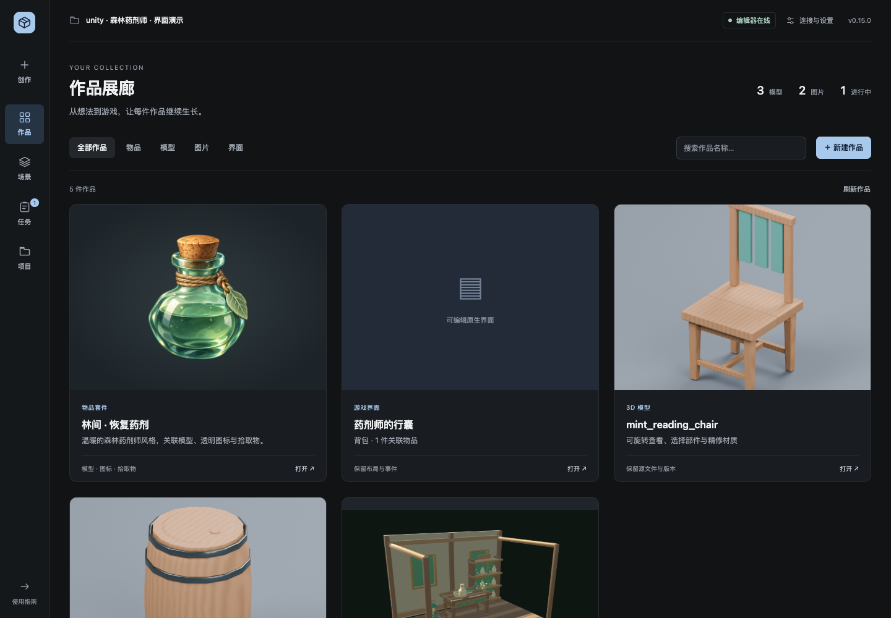
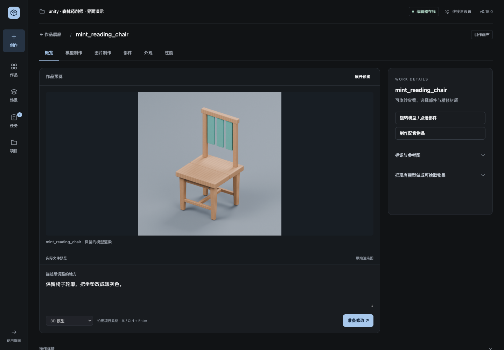

# 作品展廊与创作画布

v0.15 开发版打开应用后直接进入 **作品展廊**。首次使用时，从右上角 **连接与设置** 选择 Unity／UE 项目并安装 AI 客户端插件，再返回展廊。正式下载在 v0.15 发布前仍是 v0.14，旧版入口名称有所不同。

这里是实际产品页面的浏览器截图，使用模拟项目记录与仓库已有示例图片展示布局；编辑器状态和任务为测试数据，不代表这次运行了引擎生成。

## 五个入口

| 入口 | 用途 |
| --- | --- |
| **创作** | 新建作品。输入想法，选择物品套件、模型、图片或游戏 UI，准备给 AI 的指令。 |
| **作品** | 首页。搜索作品名称或 ID，按物品、模型、图片、界面筛选，打开已有作品继续修改。 |
| **场景** | 布置、关卡、交互和玩法套件。沿用原有制作、摆放和原生玩法功能。 |
| **任务** | 查看全部、进行中、已完成或需处理的任务；取消、恢复、查看结果。下方可制定开发计划。 |
| **项目** | 美术样本、素材库、命名整理、项目规范与自动入库。右上角进入连接与设置。 |

原来的 15 项工具都保留在这些分区中。颜色、字号、按钮、表单、通知和折叠面板共用一套样式，本地页面与支持 MCP Apps 的嵌入界面使用同一份代码。

## 新建与修改

1. 点 **新建作品**，在画布下方描述需求，例如「森林药剂师的治疗药水，配套图标与拾取物」。
2. 选择成果类型，点 **准备创作**，也可按 **⌘ / Ctrl + Enter**。支持交接的宿主会收到指令；本地页面显示可复制给 Codex／Harness 的内容。实际制作由宿主与已配置工具完成。
3. 制作完成后回到 **作品**。点击作品卡进入画布，在下方描述要调整的地方，点 **准备修改**。指令带上当前作品与稳定 ID，不会当作新建作品。
4. 右侧按需展开标识、参考图和版本。模型可以制作配套物品；物品套件可以继续创建原生界面。新建作品会重置上一件作品的专用表单，避免误更新旧资源。

画面使用已有的真实 Blender 椅子渲染；此截图展示浏览器交互，不是新的模型生成或原生引擎验证。

## 预览与精修

- **模型**：打开时读取保留的渲染，不自动启动 Blender。点 **旋转模型 / 点选部件** 后才准备真实几何视图；选部件自动进入部件工具，并保留模型画布。已有版本继续支持恢复。
- **物品**：先显示实际透明图标。右侧可查看模型、局部修改图标、更新配套图标与物品，或展开版本与关联。
- **图片**：进入后可拖出矩形，也能输入归一化选区坐标。准备局部修改后，先预览新版本，再决定采用或恢复。
- **游戏界面**：展示关联物品的结构示意并打开原生界面配置。结构示意明确标注，最终布局与事件以 Unity／UE 为准。

缺少保留预览时显示占位说明，不用其他图片代替该作品。浏览展廊只读取已有数据。图像棋盘格表示透明；模型视图的材质是近似显示，最终外观仍用真实引擎画面检查。

点 **展开预览** 收起右侧参数，按 **Escape** 或点 **收起预览** 返回。任务结果、前后对照、材质适配仍可打开真实预览；项目内的材质适配同时保留右侧应用与撤销工具。

## 任务与高级工具

生成、导入、取消与恢复的进度集中在 **任务**，导航上的数量表示正在处理或等待编辑器的任务。**需处理** 可筛出失败与取消项，错误不会显示为成功。编辑器离线时仍可准备指令，原生导入等待编辑器响应。

开发计划下方展开 **美术方向、关联更新与交付工具**，可比较三套美术、更新关联资产、接入原项目系统、迁移存档和构建游戏。[完整功能与限制](CONTINUOUS-CREATION.zh-CN.md)。

工具标签支持方向键与 Home / End。窄窗口会把画布和参数改为上下排列；顶部返回展廊后保留搜索与筛选。刷新整个页面重新进入首页，切换项目会清除旧画布和旧异步结果。

## 界面验证

`tools/ui_smoke.cjs` 使用 Playwright 与模拟 API，覆盖展廊搜索筛选、保留预览、修改上下文、3D 部件选择、图片选区、UI 配置、全部工具入口、任务筛选、项目切换时的延迟响应、本地与嵌入页面，以及 320–1440 像素窗口。它不会启动 Blender、Unity 或 UE，不会向真实项目写资产。

在已有 Node 与 Playwright 环境中运行 `node tools/ui_smoke.cjs`。默认使用已安装的 Chrome；可用 `PTS_BROWSER_CHANNEL` 指定其他已安装通道。需要检查视觉变化时才加 `--screenshots .local/ui-smoke`；完成后清理该目录。
